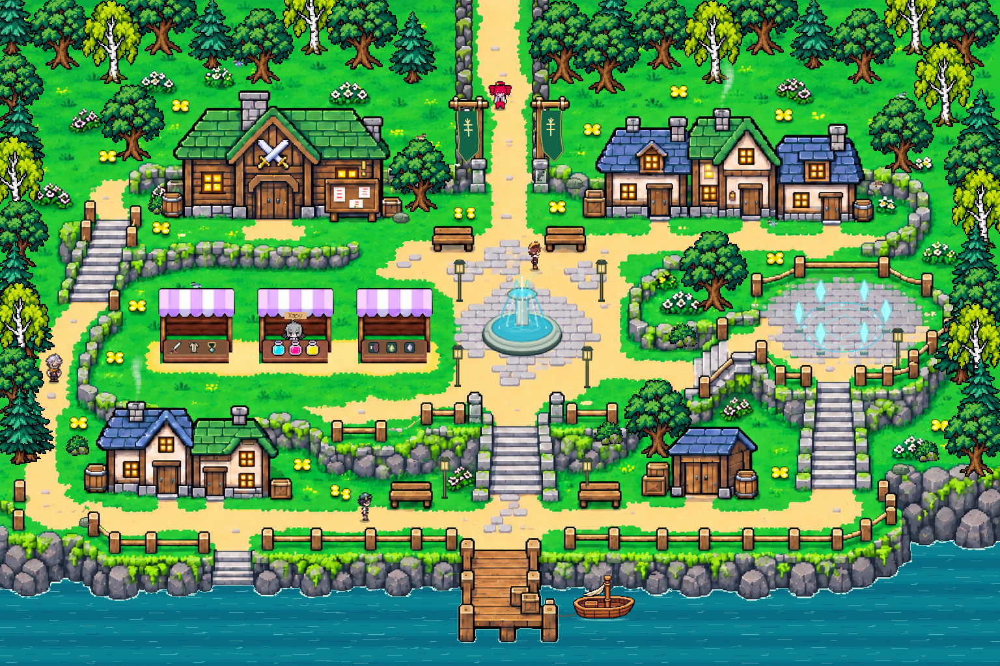

# Тихая поляна

Пиксельная RPG с Тето, Мику, Гуми и Неру. Текущая версия — **0.59**.

## Скачать игру

**[Скачать версию 0.59 — ZIP](https://github.com/pe4enka2728-ui/quiest_meadow/releases/download/v0.59/Quiet-Meadow-0.59.zip)**

Распакуйте ZIP и откройте `Play.html` в Chrome или Edge. Установка и интернет для игры не нужны.

В [Releases](https://github.com/pe4enka2728-ui/quiest_meadow/releases) также доступны отдельный HTML, архив исходников, схема коллизий и видео карты. Репозиторий открытый, файлы доступны для скачивания без входа в GitHub.



## Версия 0.59

Границы города скорректированы по разметке. Добавлена северная каменная ограда, удалены два фрагмента вместе с коллизиями. Исправлены перекрытия у лавочек, заборов и лестниц. Сохранены анимации жителей, обход Мику, магазин Хару, дом, заказы, мини-игры и бои.

Подробности: [изменения](CHANGES_059.md), [проверки](VALIDATION_059.md). Отчёты исходной сборки находятся в `verification/0.59/`.

## Сборка из исходников

Нужны Python 3.12 и Node.js 22.

```sh
python -m pip install -r requirements.txt
node --test tests/*.test.cjs
python build.py
```

Результат — автономный `play.html`. Исходная версия запускается через обычный локальный HTTP-сервер:

```sh
python -m http.server 8000
```

Откройте `http://localhost:8000/`.

## Автоматические релизы

GitHub Actions запускает тесты, собирает игру и создаёт Release при отправке тега `v<версия>`. Тег должен совпадать с `LevelData.version`. Перед новым релизом обновите версию и описание изменений, затем сохраните изменения коммитом и отправьте тег:

```sh
git push origin main
git tag v0.60
git push origin v0.60
```

Тег `v0.60` здесь приведён как пример следующего обновления. Опубликованные релизы автоматически не перезаписываются. Сборку без публикации можно запустить вручную во вкладке Actions.
